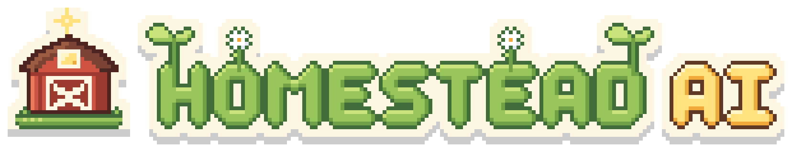
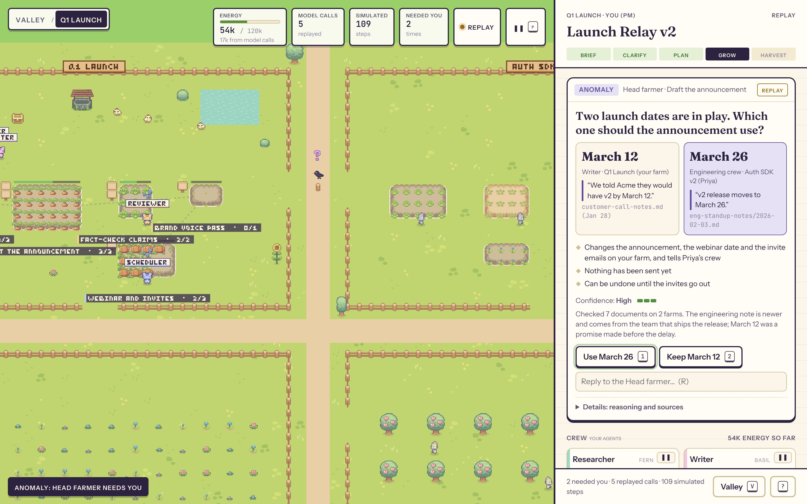
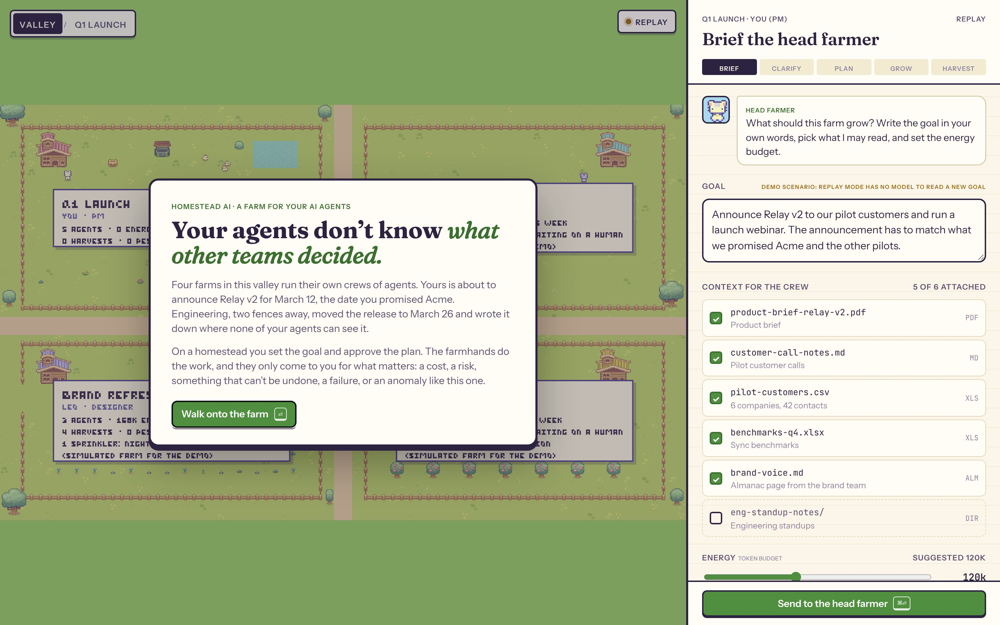
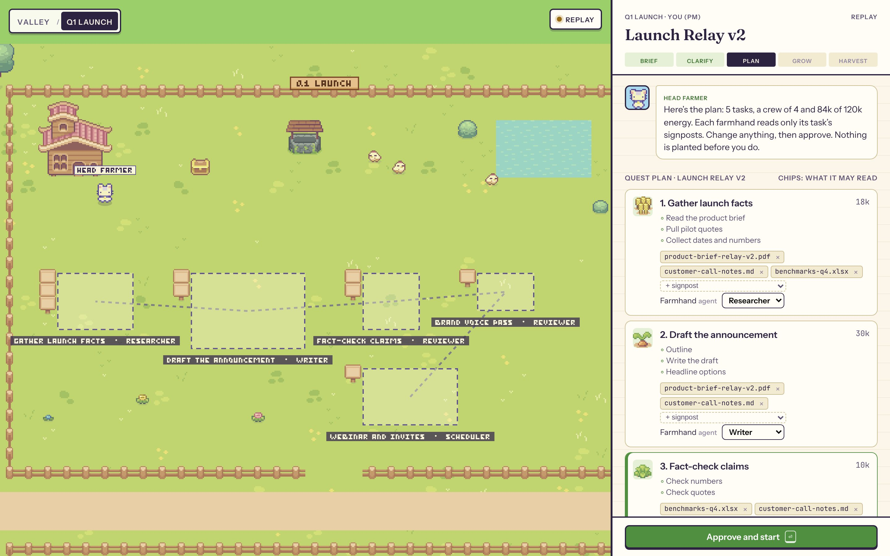
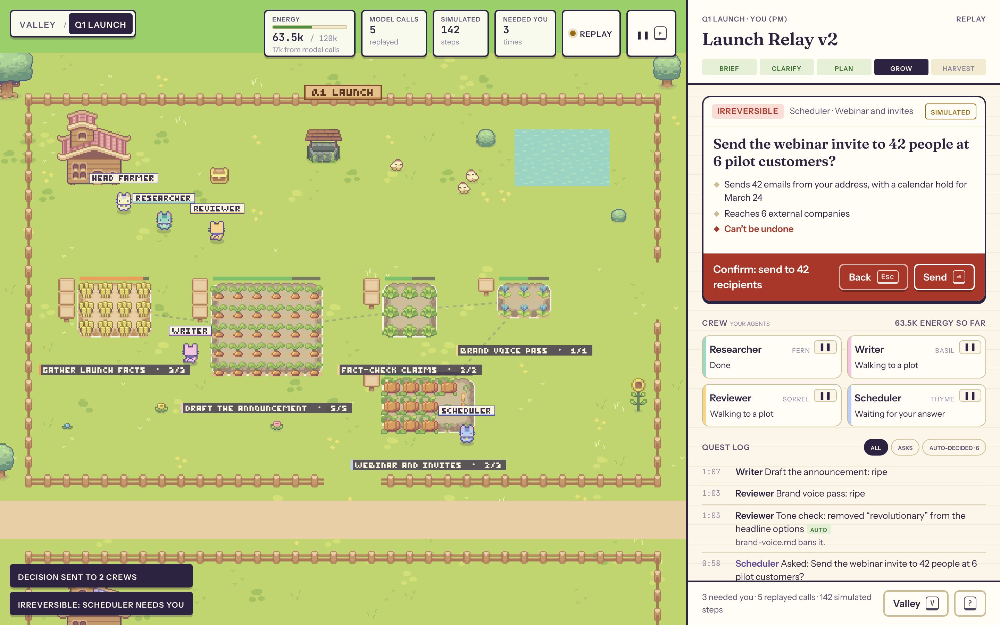
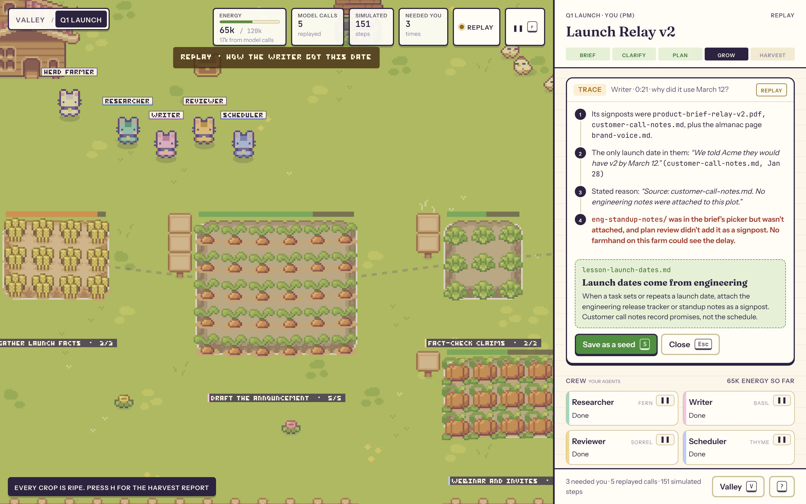
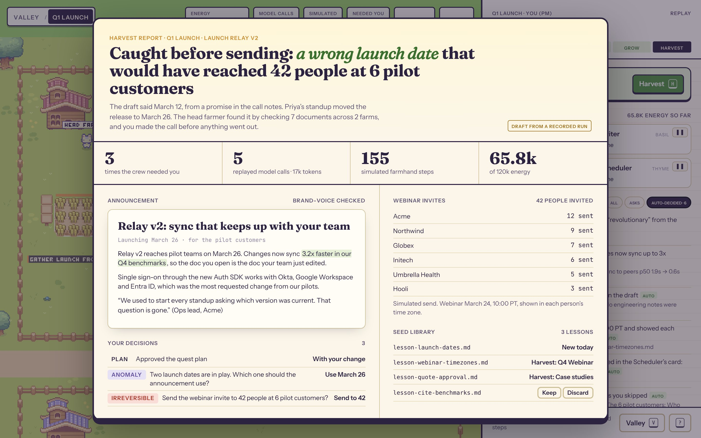
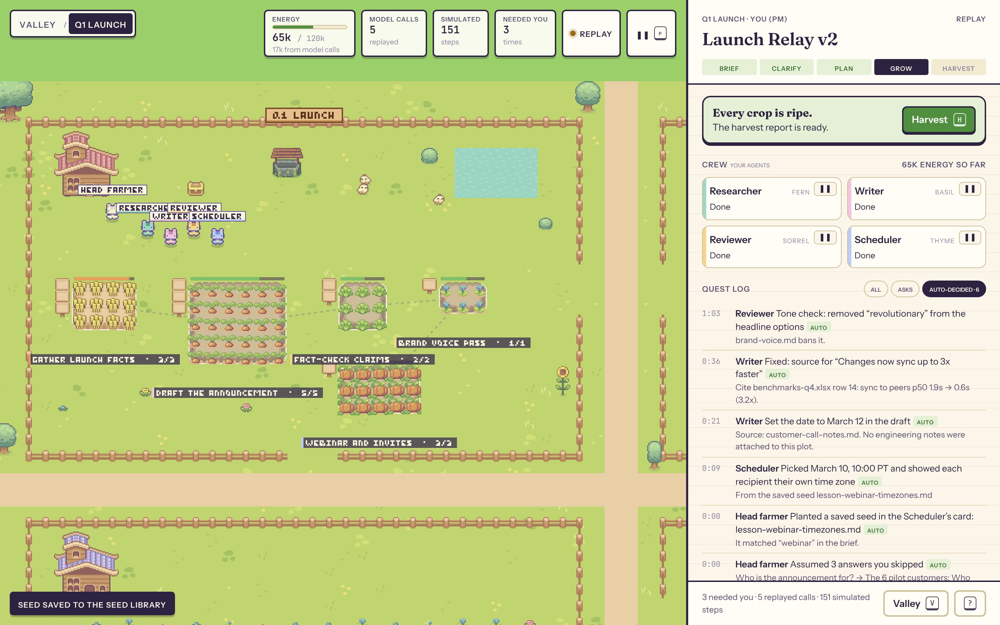
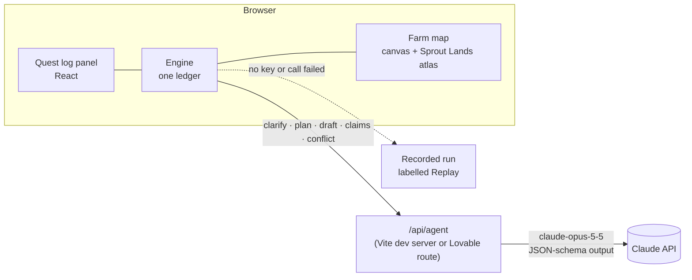

<p align="center">
  
</p>

<p align="center"><b>A farm for your AI agents.</b><br />
You set the goal and approve the plan. The farmhands do the work. They only come to you when it matters.</p>

<p align="center">
  <a href="#run-it">Run it</a> ·
  <a href="#the-demo-in-3-minutes">The demo</a> ·
  <a href="#how-it-works">How it works</a> ·
  <a href="#whats-real-and-whats-simulated">What's real</a> ·
  <a href="#credits">Credits</a>
</p>



## The problem

Agents are getting good at doing the work. They are still bad at knowing what the rest of the company decided.

A PM asks a crew of agents to announce a release to six pilot customers. The agents write a great announcement with the date the PM promised Acme on a call: March 12. Two weeks earlier, engineering moved the release to March 26 and wrote it in their standup notes. None of the PM's agents could see those notes. Without a check, 42 people at 6 customers get the wrong date, from the PM's own address.

Most agent tools give you two bad options. You can approve every step, which buries you in prompts. Or you can let the agents run, and find out afterwards.

## The idea

Homestead AI makes a multi-agent system something you can see and steer, like a farm:

| On the farm | In the system |
| --- | --- |
| **Farm** | A project |
| **Owner** (you) | The person accountable for the goal |
| **Head farmer** | The orchestrator agent: plans, assigns, watches, asks |
| **Farmhands** | Subagents, each with a role, tools and limited context |
| **Plot** | A task. Its **crops** are subtasks that grow as work gets done |
| **Signposts** | The documents a task's farmhand may read, and nothing else |
| **Energy** | Tokens. A plot turns dry when its task passes 75% of its budget |
| **Pests** | Problems an agent found, such as a claim with no source |
| **Crow** | An anomaly: facts that disagree across farms |
| **Seeds** | Lessons saved as `.md` files and planted into future crews |
| **Valley** | Every farm in the org, side by side |

Farmhands only stop you for one of five reasons, and every card says which one:

| Label | When |
| --- | --- |
| **Cost** | A task would run more than 25% over its energy |
| **Risk** | The work touches something sensitive |
| **Irreversible** | The next step can't be undone, such as sending email outside the company |
| **Failure** | A farmhand is stuck after retrying |
| **Anomaly** | Facts disagree, inside the farm or across farms |

Everything else they decide on their own, and log it under **Auto-decided** so you can audit it.

## The demo in 3 minutes

| | |
| --- | --- |
|  | **1. The valley.** Four farms, four crews of agents. Yours is about to announce Relay v2. |
|  | **2. Brief, clarify, plan.** Write the goal and pick what the crew may read. The head farmer asks three questions it can't answer from the brief, then proposes five plots, a crew of four and each task's signposts. Change any assignee or signpost, then approve. Nothing is planted before you do. |
|  | **3. The crow.** Before anything leaves the company, the head farmer checks the draft's date against everything the neighbouring farm shares, 7 documents across 2 farms. It finds the clash and shows you both sources side by side. You pick the date; the re-plan is shown as a diff before it applies, and Priya's crew is told. |
|  | **4. The one step that can't be undone.** Sending 42 invites asks twice, and the second confirm restates what will happen. |
|  | **5. Why did it do that?** Replay the moment the Writer chose March 12: its signposts, the only date in them, and the missing engineering notes. Save the lesson as a seed so the next crew starts with it. |
|  | **6. The harvest.** It leads with the outcome: a wrong date caught before it reached 42 people. Then the announcement, the invites, every decision you made, and how many model calls and simulated steps it took. |

Along the way: pause the whole farm (<kbd>P</kbd>) or a single farmhand, see the valley (<kbd>V</kbd>), and filter the log to what agents decided alone.



## Run it

```bash
npm install
npm run dev            # http://localhost:5173
```

- **Live:** put `ANTHROPIC_API_KEY=...` in `.env.local`. The head farmer, the Writer and the Reviewer then call Claude for real. The key stays on the server: the browser only talks to `/api/agent`.
- **Replay:** open `/?replay`, or run without a key. The model steps replay a recorded run of the same prompts, and every card and the top bar say **Replay**. In replay the goal is fixed to the demo scenario, because there's no model to read a new one.

Keys: <kbd>⏎</kbd> main action · <kbd>A</kbd> / <kbd>D</kbd> approve or deny · <kbd>1</kbd> <kbd>2</kbd> pick an option · <kbd>R</kbd> reply · <kbd>P</kbd> pause · <kbd>V</kbd> valley · <kbd>W</kbd> trace · <kbd>H</kbd> harvest · <kbd>?</kbd> help.

### Deploy on Lovable

The app is mirrored into a Lovable project (TanStack Start) with `scripts/sync-lovable.sh`. There, `src/routes/api/agent.ts` runs the same agent code as a server route. Add `ANTHROPIC_API_KEY` under Secrets and publish.

## How it works



- **One ledger.** Every agent action and every human decision is an entry, tagged `live`, `replay` or `sim`. Each number on screen (energy, model calls, simulated steps, how often the crew needed you) is computed from it.
- **Five live agent calls** (`src/agent/agents.ts`), each with a JSON schema so the UI can trust the shape:
  - **Head farmer · clarify** reads the goal and attached docs and asks 3 questions with options.
  - **Head farmer · plan** maps the goal onto the farm's 5 plots. Roles and signposts are enums, so it can only assign real farmhands and real documents.
  - **Writer · draft** writes from its signposts only, and reports the date it used, the date's source and every claim's source.
  - **Reviewer · claims** checks each claim against the sources. Its first issue becomes a pest on the draft.
  - **Head farmer · conflict** reads the draft's date against all 5 documents the neighbouring farm shares, including an older standup that still says March 12. A crow flies only if the model returns `conflict: true`.
- **Context is the lever.** A farmhand sees only its task's signposts. Add `eng-standup-notes/` to the draft at plan review, and the Writer uses March 26 and no crow comes. The trace teaches that lesson.

## What's real and what's simulated

We'd rather you hear it from us:

| Real | Simulated, and labelled so |
| --- | --- |
| The head farmer's questions and plan, the Writer's draft, the Reviewer's claim check and the cross-farm conflict check: 5 Claude calls with their real token counts | The farmhands' tool steps between those calls (walking, reading, "Pull pilot quotes"), counted separately as *simulated steps* |
| Every human decision and its effect on the plan | Sending the 42 invites (the card says **Simulated**) |
| The ledger and every number computed from it | The other three farms in the valley and their stats |

The Claude Code hook from the design (a real Claude Code permission prompt arriving as a card) was cut on purpose to keep the 3-minute story tight. The one-page [design rationale](docs/RATIONALE.md) explains the main choices.

## Project layout

```
src/
  agent/        agent prompts + schemas (shared by the dev server and Lovable), demo documents
  sim/          engine (ledger, farmhands, asks), scenario script, live/replay client
  map/          canvas renderer, sprite atlas loader
  panel/        brief → clarify → plan → grow → harvest
scripts/
  build-atlas.py    builds the sprite atlas from the Sprout Lands packs
  sync-lovable.sh   mirrors the app into the Lovable project
```

## Credits

- **Art:** [Sprout Lands](https://cupnooble.itch.io/sprout-lands-asset-pack) and the [Sprout Lands UI Pack](https://cupnooble.itch.io/sprout-lands-ui-pack) by **Cup Nooble**. The license allows use in projects with credit, but the packs may not be redistributed. So this repo commits only the frames the app draws, packed into `public/sprites/atlas.png` by `scripts/build-atlas.py`, plus the pack's pixel font and cursor. To rebuild the atlas, buy the packs and run `python3 scripts/build-atlas.py <folder with the unzipped packs>`. Please don't use these assets to train AI models.
- **Type:** Fraunces, Instrument Sans and JetBrains Mono, all under the SIL Open Font License, via Fontsource.
- **Logo:** made for this project in the same pixel style.
- **Built with** [Claude](https://www.anthropic.com/claude) (the agents), [Claude Code](https://claude.com/claude-code) (the build) and [Lovable](https://lovable.dev) (hosting).
